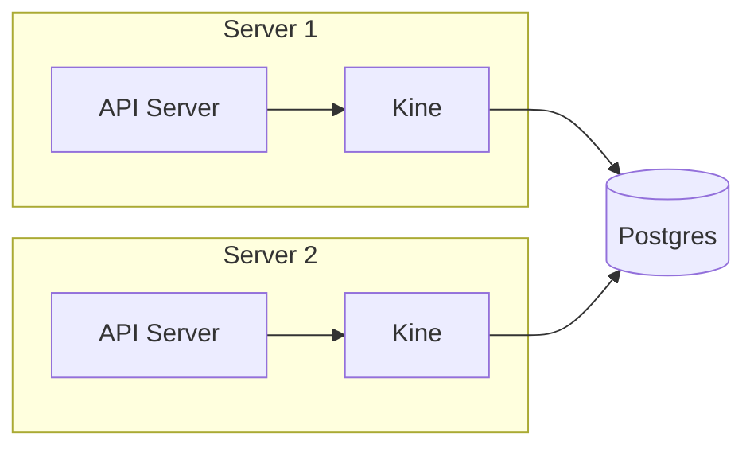
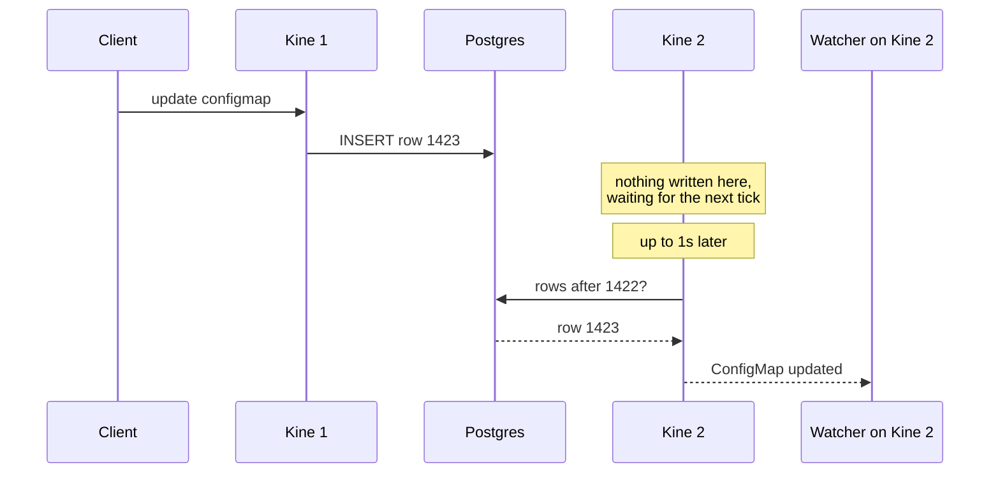
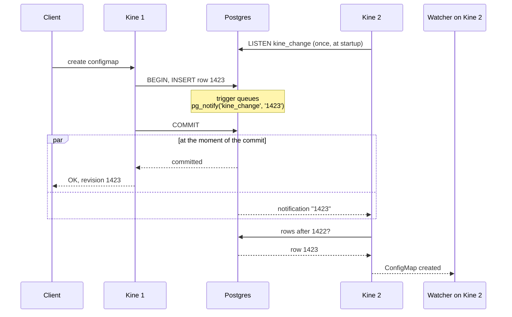
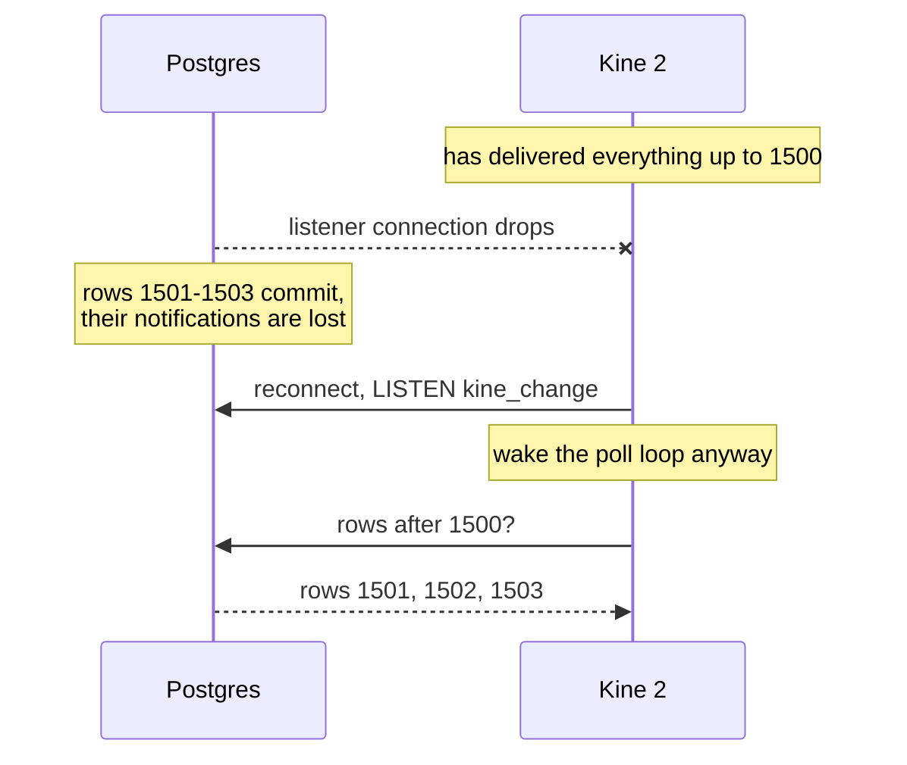
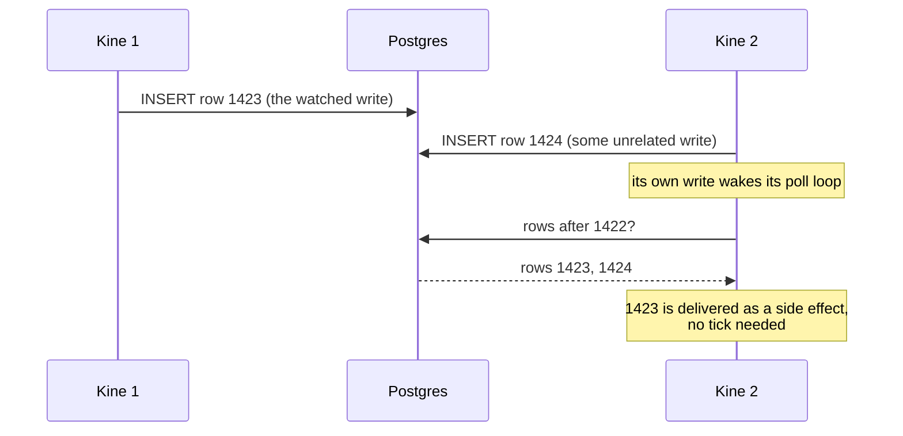
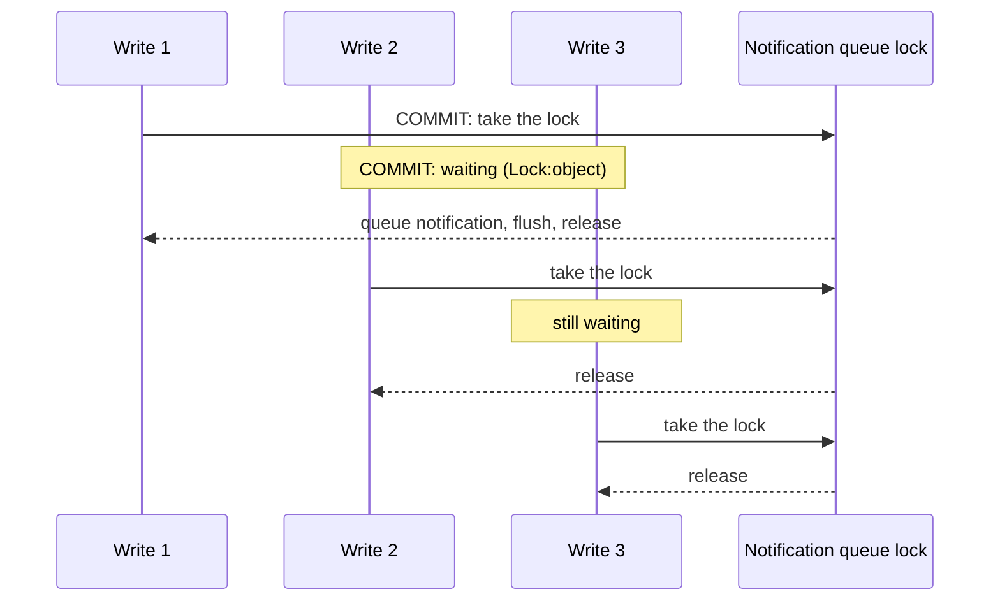
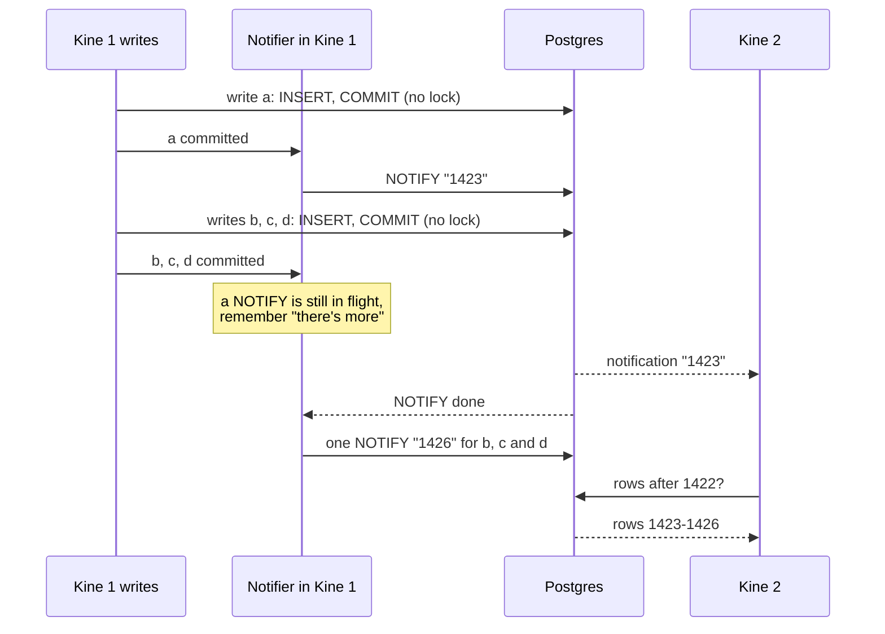
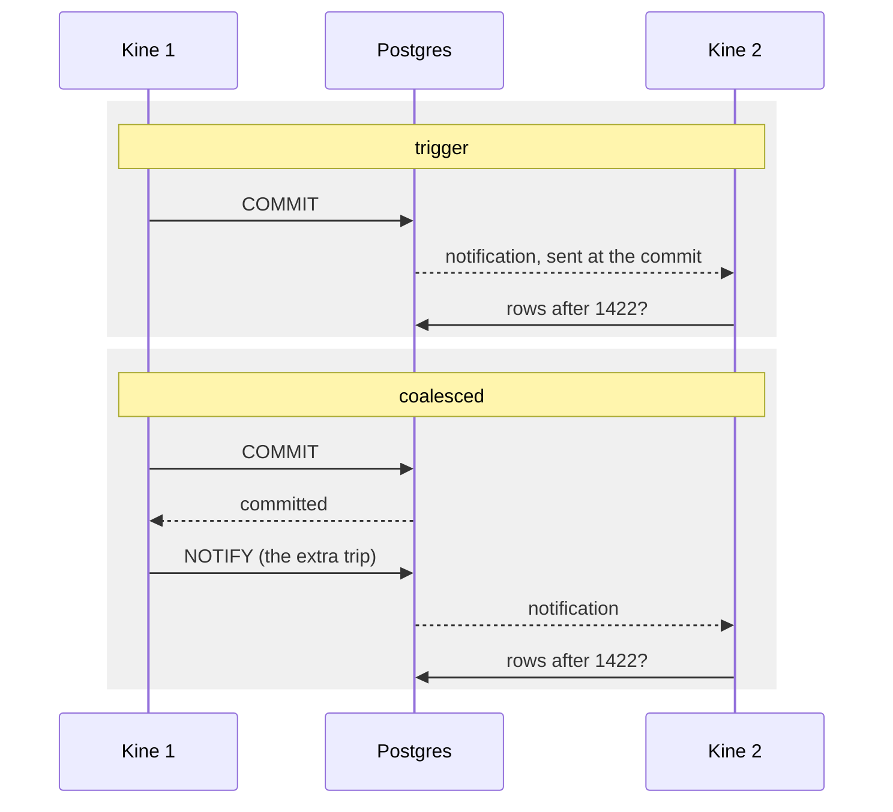

# Weekend Side Project with Kine

I had recently read about `LISTEN/NOTIFY` in Postgres, and I wondered whether Kine used it for its Postgres backend. It doesn't, and for a good reason: Kine supports SQLite, MySQL, Postgres and others with one shared code path, and polling the table works the same on all of them. I was curious what a Postgres-only feature could add on top of that, so one weekend I tried adding `LISTEN/NOTIFY` to Kine's Postgres driver in a local experiment and measured what changes.

> A quick note before we begin:
>
> This started as a weekend side project driven by curiosity. The implementation, benchmarks, and conclusions here are observations from my experiments, not definitive technical results. I've never operated PostgreSQL or Kubernetes clusters at scale, so there are almost certainly trade-offs and production considerations that I have not run into yet.

# How Kine Delivers Watches Today

This post assumes you know roughly what Kine is: it speaks the etcd API to the Kubernetes API server and stores everything in a SQL table. Every write appends a row, and the row's `id` is the etcd revision. (I wrote about how etcd itself works in [Learning etcd](learning-etcd.html).)

For watches, each Kine process runs a background loop that asks the database "give me every row after the last revision I delivered", and sends those rows to its watchers in revision order. The loop runs when one of two things happens:

1. This Kine process just wrote something. The write path wakes the loop directly.
2. The poll interval ticks. That's `--datastore-poll-interval`, 1 second by default.

With one Kine server, every write goes through that one process, so watchers hear about it right away. HA is different. In an HA K3s cluster, every server runs its own Kine, and all of them share one database:



The Kine processes never talk to each other. Unlike etcd members, there's no leader and no forwarding. Each one runs its SQL directly against Postgres, and Postgres is the only place writes are ordered. That means Kine 2 has no way to know that Kine 1 just wrote something. It only finds out when its own loop runs, either because Kine 2 also wrote something, or because a second has passed:



This happens in real clusters. The scheduler and controller manager run on whichever server holds the leader lease, while `kubectl` and kubelets reach any server through a load balancer. A pod created through server 1 reaches the scheduler on server 2 through exactly this delay.

You can lower the poll interval, but then every Kine process queries the database more often, all the time, even when nothing changes.

# The Change: LISTEN/NOTIFY

Postgres has a built-in way for one connection to tell others that something happened. A connection runs `LISTEN some_channel`, and any connection can run `NOTIFY some_channel, 'payload'`. When the notifying transaction commits, Postgres delivers the payload to every listening connection. If the transaction rolls back, nothing is sent.

That fits neatly into Kine's existing design. The poll loop already does the hard parts: reading rows in order, handling gaps, sending events. It only needs to be woken when another server writes. So the change is small, and it's an option on the existing driver:

```console
$ kine --endpoint "postgres://user:pass@db:5432/kine?listen=true"
```

With `listen=true`, Kine does two things at startup.

It adds a trigger that sends a notification with the row's id for every insert. Only the id is sent, because a notification payload is limited to about 8 KB and a Kubernetes object can be much bigger.

```sql
CREATE OR REPLACE FUNCTION kine_notify() RETURNS trigger AS $$
BEGIN
    PERFORM pg_notify('kine_change', NEW.id::text);
    RETURN NULL;
END $$ LANGUAGE plpgsql;

CREATE OR REPLACE TRIGGER kine_notify AFTER INSERT ON kine
    FOR EACH ROW EXECUTE FUNCTION kine_notify();
```

It opens one extra connection that runs `LISTEN kine_change` and waits. Every notification wakes the poll loop, the same way a local write does:

```go
for {
    n, err := conn.WaitForNotification(ctx)
    if err != nil {
        return true, err   // reconnect
    }
    rev, _ := strconv.ParseInt(n.Payload, 10, 64)
    log.NotifyRevision(rev)   // the same wake-up a local write uses
}
```

Put together, a write through Kine 1 now reaches a watcher on Kine 2 like this:



The client's reply and the notification leave Postgres at the same moment. After that, Kine 2 needs one more query to fetch the row, so the watcher gets the event about one round trip after the client is told the write succeeded. That's the number to look for in the measurements.

The notification never carries data. It only says "go look", and the poll loop then reads the rows as it always does. That keeps the correctness rules in one place, and it makes the known problems with `LISTEN/NOTIFY` easy to handle:

- Notifications can be lost. If the listening connection drops, anything sent while it was down is gone. So after every reconnect, Kine wakes the poll loop anyway, and the loop catches up from the last revision it delivered. The normal poll interval also keeps running as a backup. A lost notification can delay an event, but it can't lose one.
- `NOTIFY` takes a database-wide lock when a transaction commits. This is the real cost, and it's measured below.
- `LISTEN` needs a real connection. It doesn't work through PgBouncer in transaction-pooling mode, so each Kine process needs one direct connection to Postgres.

This is what the catch-up after a dropped connection looks like:



# How I Measured It

Everything ran on my Mac, in two VMs made with [vfkit-nix](vfkit-nix.html): one for PostgreSQL 17 (2 vCPUs, 2 GB) and one for the Kine processes and load generators (4 vCPUs, 4 GB). Every test ran two Kine processes on the same database, the HA layout, on a fresh database each time.

To see what network distance does, I added delay between the VMs with `tc netem`:

| Case | Round trip to Postgres | Meant to look like |
|---|---|---|
| Same data centre | ~0.5 ms | Self-hosted Postgres next to Kine |
| Same region | ~3 ms | A managed database (RDS, Cloud SQL) in the same region. |
| Cross-region | ~12.5 ms | A database in another region, or over a VPN |

These distances are simulated. The round-trip times are my assumptions about what each setup typically looks like, not measurements of real networks, and a fixed delay doesn't model jitter, packet loss or TLS. Both VMs also share the Mac's CPU, which matters for the same-data-centre numbers.

I compared three configurations of the same Kine build:

- upstream: the Postgres driver as it is, polling every second.
- poll 100 ms: the same, with `--datastore-poll-interval=100ms`. This is what you can already do today without any code change.
- listen: the same driver with `?listen=true`.

For load, I used the etcd v3 benchmark tool, and a small Go tool of my own for what the benchmark tool can't do: write through one Kine server while watching on the other, and check that every acknowledged write shows up in the watch exactly once, in order.

# What It Gains: Faster Watches Across Servers

One client writes through Kine 1, and a watcher on Kine 2 records when each event arrives. Nothing else is writing, so Kine 2's loop isn't woken by writes of its own. Average time from starting a write to the watcher receiving it, over 200 writes:

| | Same data centre | Same region | Cross-region |
|---|---|---|---|
| upstream | 969 ms | 962 ms | 967 ms |
| poll 100 ms | 70 ms | 67 ms | 68 ms |
| listen | 6 ms | 15 ms | 50 ms |

Upstream is just the poll interval: about one second, whatever the network does. A 100 ms poll interval gets it down to about 70 ms. With `listen`, the event arrives about one round trip after the write finishes.

The 100 ms poll has a cost of its own. With both Kine servers idle, the database handled 20 transactions per second for poll 100 ms, against 2 for upstream and 2 for listen. Polling asks "anything new?" ten times a second whether anything changed or not.

When both servers are busy, the gap mostly disappears. I repeated the test while ten background clients were writing through both Kine servers. Now Kine 2's loop is constantly woken by its own writes, and each time it reads everyone's new rows:



| Busy servers | Same data centre | Same region | Cross-region |
|---|---|---|---|
| upstream | 9.7 ms | 10.4 ms | 53 ms |
| poll 100 ms | 9.6 ms | 10.2 ms | 52 ms |
| listen | 8.1 ms | 9.6 ms | 44 ms |

So the one-second delay isn't constant. It hits when the server whose watcher matters is quiet, and a control plane is quiet most of the time: no rollouts, just leases renewing every few seconds. The first change after a quiet gap is the one that waits.

On a single Kine server, all three behave the same, because the write itself wakes the loop.

# What It Costs: Write Throughput

The documented cost of `NOTIFY` is the lock it takes at commit. Postgres keeps notifications in one shared queue in commit order, and every committing transaction that sent one takes the same lock to add to it. So commits that send notifications happen one at a time:



Without the trigger, the same three commits would run side by side, and Postgres could write all three to disk in one flush.

Twenty writers split across both Kine servers, creating keys for 15 seconds:

| Writes per second | Same data centre | Same region | Cross-region |
|---|---|---|---|
| upstream | 13,151 | 2,836 | 532 |
| poll 100 ms | 12,514 | 2,640 | 580 |
| listen | 4,434 | 2,810 | 560 |

The etcd benchmark tool's `put` with 50 clients showed the same pattern in the same data centre: 6,956 against 4,063 writes per second. Further away it was less clear-cut. In the same region, `listen` was 10% slower in this run and 28% slower in a later one. Cross-region, the two were equal.

The same-data-centre drop is the one result limited by CPU instead of the network, and both VMs share one Mac. So I repeated it three times, alternating the two configurations, and sampled what Postgres sessions were waiting on every 100 ms:

- upstream: 9,594-13,285 writes/s. Sessions mostly waited on writing the WAL (`LWLock:WALWrite`), which is normal for many commits in flight.
- listen: 4,029-4,938 writes/s. Sessions mostly waited on `Lock:object`, which never appeared without the trigger. That's the notification queue lock.

Why does the cost disappear with distance? The lock is held only while Postgres commits, never while data travels over the network. When each write spends a few milliseconds on round trips, writers rarely reach the lock at the same moment. With Postgres half a millisecond away, there's nothing to hide behind, and the commit becomes the bottleneck.

Reads aren't affected, since they don't insert anything.

# Taking NOTIFY Out of the Write

Every write pays for the lock only because the trigger sends a notification from inside the write's own transaction. But the notification is only a wake-up: it says "go look", and the other servers then read every new row anyway. It doesn't need to come from the write itself, and there doesn't need to be one per write.

So I tried a second mode, `?listen=true&notify=kine`. There's no trigger, and writes are plain inserts, exactly as without `LISTEN/NOTIFY`. After a write commits, Kine tells a small notifier in the same process, which sends `NOTIFY` on its own connection:



If writes finish while a `NOTIFY` is still in flight, the notifier doesn't send one for each of them. It remembers that there's more, and sends one extra `NOTIFY` when the current one returns. A burst of a thousand writes becomes a handful of notifications, and no write ever waits for the lock. Each server also ignores the notifications its own notifier sent, since its poll loop already knows about its own writes.

I ran the throughput tests again with all three modes in one session (three runs in the same data centre, two elsewhere, averaged):

| Writes per second, two servers | Same data centre | Same region | Cross-region |
|---|---|---|---|
| no `LISTEN/NOTIFY` | 11,771 | 2,798 | 583 |
| listen, trigger | 4,338 | 2,809 | 602 |
| listen, coalesced | 10,318 | 2,813 | 594 |

| `put`, 50 clients | Same data centre | Same region | Cross-region |
|---|---|---|---|
| no `LISTEN/NOTIFY` | 7,826 | 7,045 | 1,469 |
| listen, trigger | 3,786 | 5,041 | 1,520 |
| listen, coalesced | 7,004 | 6,502 | 1,495 |

`Lock:object` disappeared from the wait samples. In the same data centre, the coalesced mode reached about 90% of the throughput without `LISTEN/NOTIFY`, against 37-48% for the trigger.

The price is a little watch latency. With the trigger, Postgres sends the notification at the moment of the commit. With the coalesced notifier, the commit's reply first has to travel back to Kine, and then the `NOTIFY` is a separate request:



Cross-server watch delivery with quiet servers, from the same session:

| | Same data centre | Same region | Cross-region |
|---|---|---|---|
| no `LISTEN/NOTIFY` | 968 ms | 968 ms | 954 ms |
| listen, trigger | 3.9 ms | 13.4 ms | 49.7 ms |
| listen, coalesced | 4.9 ms | 16.2 ms | 61.4 ms |

Cross-region, that's 11.7 ms more, about one round trip. It's still far below the poll interval.

There are two other trade-offs:

- Only writes made through Kine send notifications. Nothing else should write to the table, but the trigger doesn't depend on that.
- If a Kine process dies between a commit and its notification, other servers see that write on their next poll tick instead. That's a delay, not a lost event, and the same as without `LISTEN/NOTIFY`.

# When It's Worth It

`LISTEN/NOTIFY` does one thing well: in an HA setup, a write through any Kine server reaches watchers on every other server within about one round trip instead of up to a second, without extra polling. The gain is largest when servers are quiet, which describes most control planes most of the time.

Sending `NOTIFY` from a trigger in every write is the simplest version, but it makes every commit take the same lock, which costs a lot of write throughput when Postgres is close. Sending it from Kine after the commit, merged across bursts, avoids almost all of that, for about one extra round trip on watch delivery. If I were to propose either, it would be the coalesced one.

Either way, it needs direct connections to Postgres for listening (and notifying), so it doesn't work through a transaction-pooling PgBouncer. That alone is a reason for it to be opt-in, which is how I built it.

I haven't tested this on real machines and a real network, through a database failover, on large clusters, or against the Kubernetes conformance suite.

From what I understand, Kine isn't trying to be faster than etcd. It trades storage performance for not having to run an etcd cluster, and it makes that trade-off across many databases with one simple design. `LISTEN/NOTIFY` doesn't change that trade-off. It's one Postgres-specific option that narrows the gap between an HA setup and a single server.
