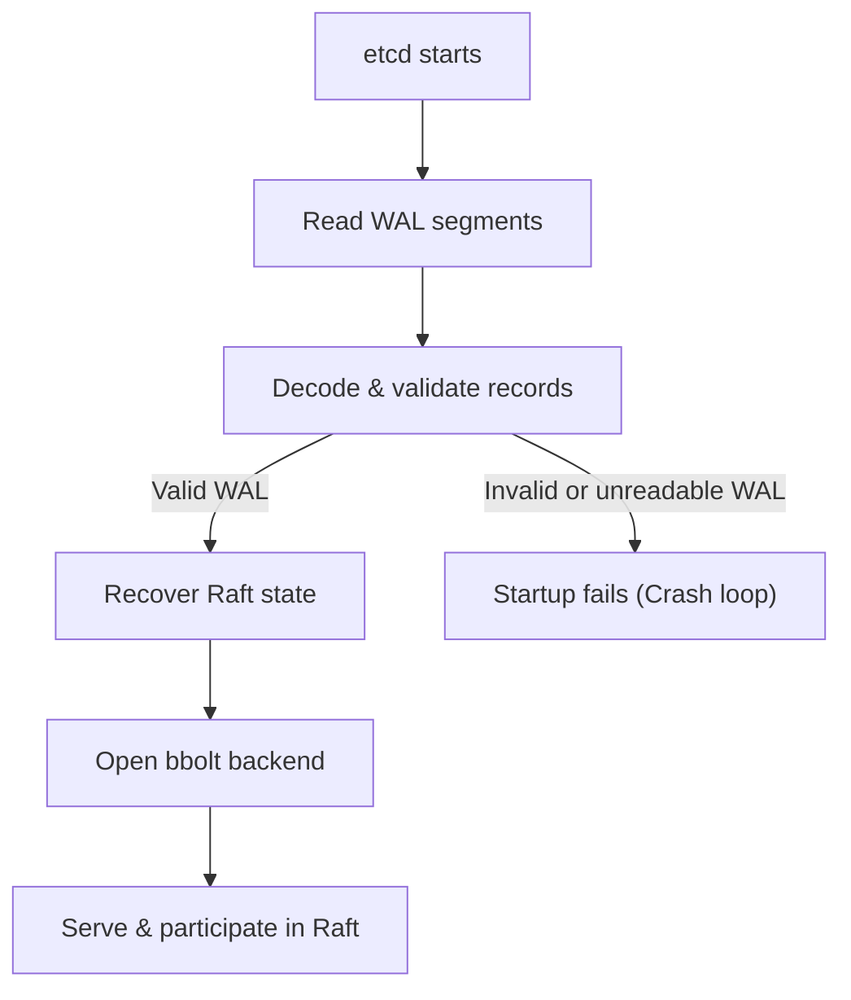
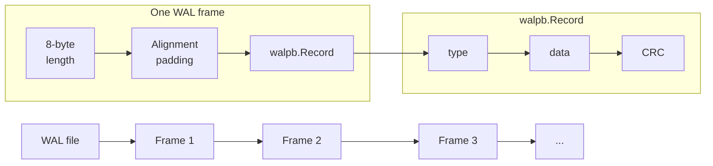
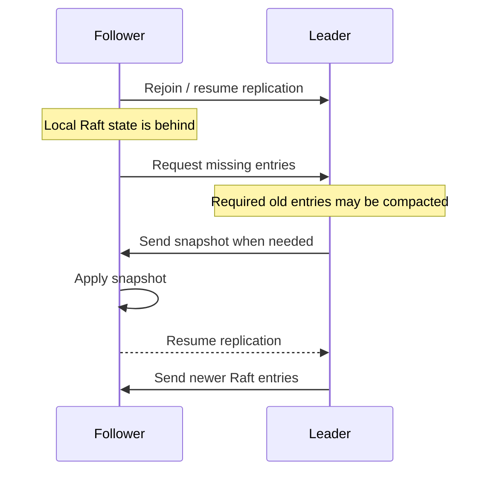

# Learning Concepts While Fixing etcd

Recently at work, two of the etcd nodes in our 3-node Kubernetes cluster ran out of disk space completely. When a root disk hits 100%, `containerd`, `kubelet`, and `etcd` can't write temporary files or append to logs, hence the failure. I resized the cloud VM disks, ran `growpart` to expand the partitions, and ran `resize2fs` on the filesystems. Once the disks had free space again, `kubelet` and `containerd` recovered nicely, and the nodes went back to `Ready` in Kubernetes.

Except etcd on one node was stuck in a crash loop:

```text
"error":"wal: max entry size limit exceeded"
```

Well, at least the other two nodes were still running, so the cluster had quorum and we didn't have total downtime. Normally, the fix here is pretty straightforward: you just remove the broken etcd member, wipe its data directory, add it back to the cluster, and let it catch up from the healthy peers. But since this was just a dev cluster, I really wanted to figure out what had actually happened to the data when the disk filled up, and why etcd was refusing to start even after the disk had plenty of free space.

# How etcd Recovers Its State

Before this, my rough mental model of etcd was pretty basic: it starts up, reads its data from disk, talks to its peers, and starts handling traffic. But when you look closer at the startup path, there is a lot happening before it ever serves a single request.

When etcd boots up, it replays its WAL segments one by one to rebuild its exact Raft state. If anything in the WAL looks corrupt or cannot be decoded properly, etcd crashes immediately.



This explained why simply fixing the disk wasn't enough. The disk issue was gone, but the WAL left behind had some bad data that etcd couldn't make sense of.

# A Help from Claude

When I first saw `wal: max entry size limit exceeded`, the error didn't make any sense. Google was telling me that the WAL entry was larger than the allowed internal limit (like 10 MB), but looking at the files on disk, none of the WAL segment files were anywhere close to exceeding that limit.

So I hopped on Claude which we use at work with a hunch that etcd was likely in the middle of writing a record right when the disk hit 100%, and somehow and something in write got cut off and corrupted. Following that hunch, I looked into the reader mechanics: etcd reads individual frames sequentially. It turned out that was exactly what happened, i.e. etcd had managed to write the 8-byte frame length header, but when it tried to write the actual record payload, the disk ran out of space.

On startup, etcd reads that 8-byte header, expects a record of that length, but hits EOF because the payload bytes were never written. Since the promised data is missing, the decoder throws `wal: max entry size limit exceeded`.

# Anatomy of an etcd WAL File

etcd stores WAL files under `/var/lib/etcd/member/wal/` named with a sequence and index pattern like `0000000000000000-0000000000000000.wal`.

Inside each file, records are stored as frames:
- An **8-byte frame length** (which tells etcd how big the record is, plus some padding flags).
- **Alignment padding** (0 to 7 bytes to align things to 8-byte boundaries).
- The **serialized `walpb.Record`** (a protobuf containing the record type, the raw data, and a CRC checksum).



Looking back at the error log, etcd had given the exact byte offset where it died: offset `324224`.

Here is what that looked like conceptually:

```text
WAL file
│
│  ... previous valid frames ...
│
├── offset 324224
│   ┌──────────────────────────────────┐
│   │  8-byte frame length             │
│   │  5e 22 00 00 00 00 00 00         │  <-- Says 8,798 bytes are coming
│   ├──────────────────────────────────┤
│   │  alignment padding               │
│   ├──────────────────────────────────┤
│   │  serialized walpb.Record         │
│   │  [MISSING / TRUNCATED PAYLOAD]   │  <-- Disk ran out of space!
│   └──────────────────────────────────┘
```

# Reading the Bytes with `od`

I wanted to see what was sitting at that exact offset `324224`. Since the WAL is a binary file, `cat` or `less` wasn't going to help. I asked Claude how I could inspect raw hex at a specific offset without dumping the entire file, and it suggested `od` (octal dump):

```bash
$ od -A d -t x1 -N 16 -j 324224 \
    /var/lib/etcd/member/wal/0000000000000000-0000000000000000.wal

0324224  5e 22 00 00 00 00 00 00  ...
```

The first 8 bytes at offset `324224` were:

```text
5e 22 00 00 00 00 00 00
```

Since x86-64 is little-endian, `5e 22` represents `0x225e`, which is `8798` in decimal.

So the header was telling etcd: "Hey, there's an 8,798-byte record right here." But because the disk filled up right as that header was written, no actual payload data followed. When etcd tried to read 8,798 bytes from that spot, it hit the end of the file and probably logged that file size limit exceeded.

# Patching the WAL with `dd`

At this point, I had an idea: what if I just fix the WAL file directly? If the problem is just this one incomplete frame at the tail end of the log, can we remove or zero out this header so etcd thinks the file cleanly ends right before it?

In etcd's WAL decoder, if a frame length is `0`, it considers that the end of valid records in that segment. So my plan was to overwrite those 8 length bytes at offset 324224 with zeros. That way, etcd would recover all the valid records up to offset 324224, see `0`, assume that's the end of the log, and finish starting up cleanly.

I knew `dd` existed, but I asked Claude how to use it to surgically overwrite just those 8 bytes in place without truncating or wiping the rest of the file. It gave me the exact flags to use: `seek=324224`, `bs=1`, `count=8`, and `conv=notrunc`:

```bash
$ dd if=/dev/zero \
    of=/var/lib/etcd/member/wal/0000000000000000-0000000000000000.wal \
    bs=1 count=8 seek=324224 conv=notrunc

8+0 records in
8+0 records out
8 bytes copied
```

I double checked with `od` to verify:

```bash
$ od -A d -t x1 -N 16 -j 324224 \
    /var/lib/etcd/member/wal/0000000000000000-0000000000000000.wal

0324224  00 00 00 00 00 00 00 00 00 00 00 00 00 00 00 00
```

Then I restarted etcd:

```bash
$ systemctl restart etcd
```

And it started up. Damn.

# How the Follower Caught Up

There is a reason why it is a practice to remove the bad etcd node, add the new node so it catches up and then becomes the participant in election. This node had been down while the other two nodes were busy processing Kubernetes requests, so its local Raft log was behind the rest of the cluster. For it to catch up, it needs to recieve a full Raft snapshot.

Normally, the leader just sends missing log entries to the follower over Raft (`AppendEntries`). But etcd periodically compacts old Raft logs so the WAL and memory don't grow forever. If the entries this node missed were already compacted away on the leader, the leader can't replay them one by one.

Instead, the leader sends a full Raft snapshot. The follower downloads the snapshot, applies it to its local `bbolt` database and state machine to fast-forward to the current state, and then resumes normal replication from there.



Within a few seconds, the follower applied the snapshot and was fully caught up. Running `etcdctl endpoint health` showed all three members healthy again:

```bash
$ etcdctl endpoint health --write-out=table
+------------------------+--------+-------------+-------+
|        ENDPOINT--------| HEALTH |    TOOK     | ERROR |
+------------------------+--------+-------------+-------+
| https://10.0.0.11:2379 |   true |  8.32145ms  |       |
| https://10.0.0.12:2379 |   true |  7.91234ms  |       |
| https://10.0.0.13:2379 |   true |  9.10452ms  |       |
+------------------------+--------+-------------+-------+
```

# What I Took Away From This

Tools like `od` are surprisingly fun and I did not know `dd` could be used in that way.

Of course, if this happened on a production cluster, I would definitely just remove and recreate the member the normal way. But having the room in a dev cluster to trace the WAL bytes, understand Raft log compaction, and see snapshots catch up in real time was, well, fun.
