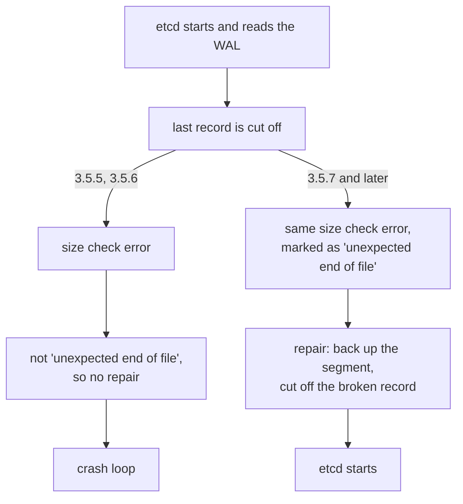
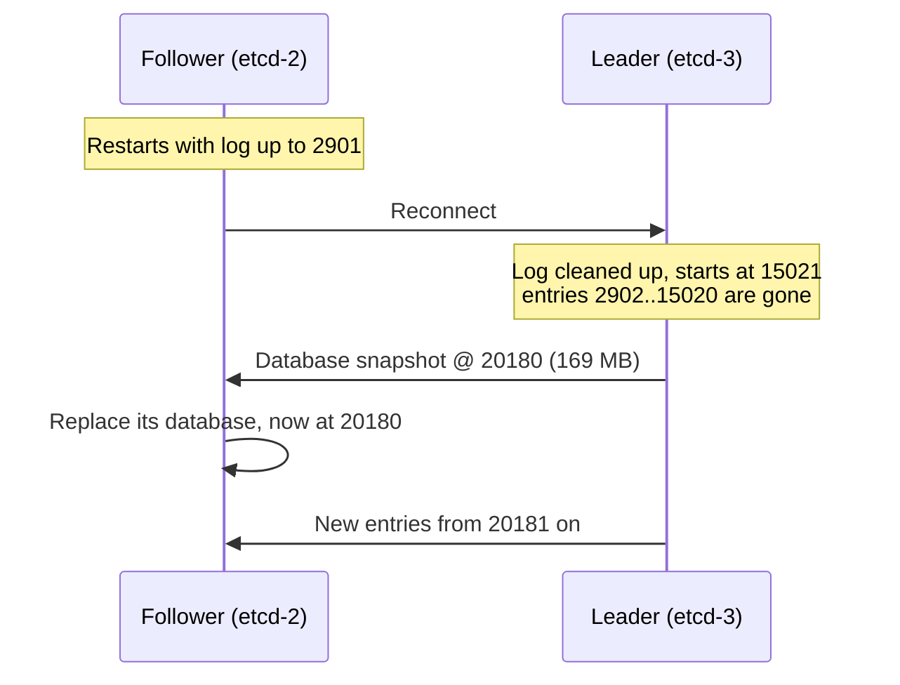
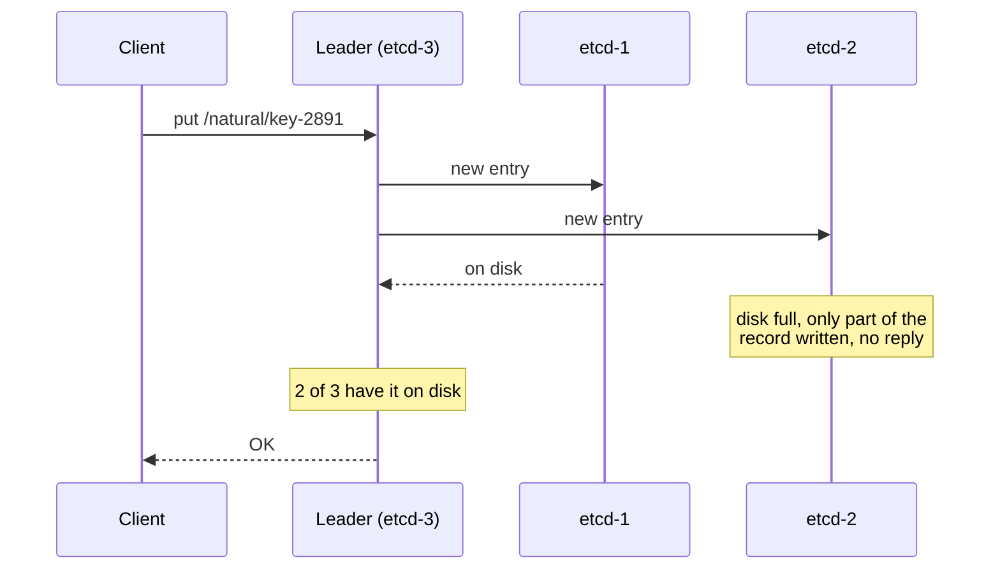

# Learning Concepts While Fixing etcd

Recently at work, two of the etcd nodes in our 3-node Kubernetes cluster, running etcd 3.5.5, ran out of disk space completely. When a root disk hits 100%, `containerd`, `kubelet` and `etcd` can't write temporary files or append to logs, so everything on the node starts failing. I resized the cloud VM disks, ran `growpart` and `resize2fs`, and once there was free space again, `kubelet` and `containerd` recovered and the nodes went back to `Ready`.

Except etcd on one node was stuck in a crash loop:

```text
"error":"wal: max entry size limit exceeded"
```

The other two nodes still had quorum, so there was no downtime. The normal fix is to remove the broken member, wipe its data directory, add it back and let it catch up from its peers. But this was a dev cluster, and I wanted to know what had actually happened to the data, and why etcd refused to start even with plenty of free space.

So I left the member as it was and went digging. I found a record in etcd's log that the full disk had cut off halfway, and I got etcd running again by zeroing 8 bytes of the file by hand. That fix wasn't my idea: I was working through it with Claude, and it suggested looking at the raw bytes with `od` and zeroing the broken record with `dd`. Removing and re-adding the member would have been quicker, but it would have wiped the evidence, and I'd have learnt nothing.

Even after it worked, I couldn't fully explain why the error talked about a size limit, why etcd didn't fix itself, or why my patch was safe. So I reproduced the whole thing on a lab cluster.

# The Lab

Three small VMs, `etcd-1`, `etcd-2` and `etcd-3`, each running etcd 3.5.5 as a systemd service, with the data directory on its own 2 GB disk at `/data/etcd`. etcd-3 is the leader, and etcd-2, a follower, is the one I break. The only unusual setting:

```yaml
snapshot-count: 1000
```

etcd takes a snapshot and throws away old log entries every `snapshot-count` writes. The default is 100,000, so this makes snapshots happen much sooner.

# What etcd Keeps on Disk

```console
$ sudo ls -la /data/etcd/member/wal /data/etcd/member/snap
/data/etcd/member/snap:
-rw------- 1 etcd etcd    24576 Nov 21 19:56 db

/data/etcd/member/wal:
-rw------- 1 etcd etcd 64000000 Nov 21 19:56 0.tmp
-rw------- 1 etcd etcd 64000000 Nov 21 19:56 0000000000000000-0000000000000000.wal
```

There are two things here:

- `member/wal/` is the write-ahead log (WAL). Every write to the cluster is appended here before etcd acts on it, along with Raft's own bookkeeping (the current term, who it voted for, how far it has committed). The log is split into files called segments, and etcd reserves 64 MB for each one up front, so appending to a segment doesn't need any new disk space. `0.tmp` is the next segment, reserved in advance.
- `member/snap/db` is the database, the actual keys and values you get from `etcdctl get`. It's what you end up with after applying everything in the log.

When etcd starts, it reads the WAL from the beginning to rebuild its state. If it hits a record it can't read, it stops. There's one exception: if the problem is a cut-off last record, etcd knows how to repair it. That exception is the whole story here.

# Breaking It the Same Way

At work, the disk filled up while other processes kept writing to it. To get the same effect, I filled the disk on etcd-2 and ran a script that keeps appending to a file, retrying every 10 ms when the disk is full, so any space that gets freed is taken again almost immediately:

```bash
while true; do
  dd if=/dev/zero of=/data/hog bs=4K count=64 oflag=append conv=notrunc status=none 2>/dev/null || sleep 0.01
done
```

At the same time, a loop on etcd-1 kept writing keys with ~8 KB values to the cluster. Within about 10 seconds, etcd-2 went through four different failures (systemd restarts it every 2 seconds):

```json
{"ts":"20:09:09.416Z","level":"fatal","msg":"failed to commit tx","error":"write /data/etcd/member/snap/db: no space left on device"}
{"ts":"20:09:11.558Z","level":"fatal","msg":"failed to read WAL, cannot be repaired","error":"no space left on device"}
{"ts":"20:09:13.825Z","level":"fatal","msg":"failed to save Raft hard state and entries","error":"write /data/etcd/member/wal/0000000000000000-0000000000000000.wal: no space left on device"}
{"ts":"20:09:16.037Z","level":"fatal","msg":"discovery failed","error":"wal: max entry size limit exceeded, recBytes: 8060, fileSize(23445504) - offset(23444536) - padBytes(4) = entryLimit(964)"}
```

The last one is the error from work, and from then on it was the only one, every two seconds. The WAL segment had also shrunk:

```console
$ sudo ls -l /data/etcd/member/wal
-rw------- 1 etcd etcd        0 Nov 21 20:09 0.tmp
-rw------- 1 etcd etcd 23445504 Nov 21 20:09 0000000000000000-0000000000000000.wal
```

Here's what happened, one restart at a time:

1. The database runs out of space first. The WAL segment already has its space reserved, but the database file has to grow, and it can't. etcd exits.
2. The WAL segment loses its reserved space. Every time etcd starts, it tidies up the end of the last segment: it cuts the file off right after the last valid record, then asks the filesystem to reserve the space again. On a quiet disk, that space is still free and this works. Here, the hog script grabbed it first, the reservation failed, and the segment stayed short. That's the `failed to read WAL` line. `0.tmp` couldn't reserve its space either, so it's 0 bytes.
3. A write runs out of space halfway through a record. The segment no longer has space reserved, so every append has to grow the file. One of them stopped partway through a record, at a 4 KB block boundary (23,445,504 is exactly 5,724 × 4,096).
4. Crash loop. The last record in the WAL is now incomplete, and every start fails on it.

Then I did what we did at work and freed the disk:

```console
$ sudo systemctl stop hog; sudo rm /data/hog
$ df -h /data
Filesystem      Size  Used Avail Use% Mounted on
/dev/vdb        2.0G   46M  1.8G   3% /data
$ sudo systemctl reset-failed etcd; sudo systemctl start etcd
Job for etcd.service failed because the control process exited with error code.
```

Same error, with 1.8 GB free. The problem is in the file now, not the disk.

# Reading the Cut-Off Record

The error tells you where the bad record starts: offset `23444536`. To make sense of the bytes there, you need to know how the WAL stores a record. Each one looks like this:

- an 8-byte header with the record's length,
- the record itself,
- 0 to 7 bytes of padding, so the next record starts at a multiple of 8. The last byte of the header says how much padding there is.

A header of all zeros means "nothing more here". The unused part of a segment is all zeros, so that's how etcd knows where the log ends.

`od` shows the bytes at that offset (`-A d` for decimal offsets, `-t x1` for hex bytes, `-j` to skip to the offset):

```console
$ sudo od -A d -t x1 -j 23444536 /data/etcd/member/wal/0000000000000000-0000000000000000.wal
23444536 7c 1f 00 00 00 00 00 84 08 02 10 90 97 dc f7 0d
23444552 1a f1 3e 08 00 10 02 18 d6 16 22 e7 3e 22 d6 3e
23444568 0a 11 2f 6e 61 74 75 72 61 6c 2f 6b 65 79 2d 32
23444584 38 39 31 12 c0 3e 4a 43 47 64 4a 35 6f 71 63 57
...
23445496 54 65 48 4e 77 49 4a 36
23445504
```

- The first 8 bytes, `7c 1f 00 00 00 00 00 84`, are the header. The bytes are stored lowest first, so the length is `0x1f7c`, which is 8,060 bytes. The `84` at the end means 4 bytes of padding.
- `08 02` right after says this record is a Raft entry, which is a write to the cluster.
- A few lines in, you can read the key as text: `2f 6e 61 74 75 72 61 6c ...` is `/natural/key-2891`, one of the keys my load loop was writing.

The whole record needs 8,072 bytes (8 for the header, 8,060 for the record, 4 for padding). The file ends at `23445504`, so only 968 of them made it to disk.

# Why the Error Talks About a Size Limit

Before reading a record, etcd checks that the length in its header fits in what's left of the file. Here, that's 23,445,504 − 23,444,536 − 4 bytes of padding = 964 bytes. The header says 8,060, so etcd refuses to read past the end of the file, and reports it as:

```text
recBytes: 8060, fileSize(23445504) - offset(23444536) - padBytes(4) = entryLimit(964)
```

So the "limit" is just how many bytes are left in the file. The name comes from an older version of this check, which compared the record against a fixed 10 MB maximum. 3.5.5 changed the check to use the remaining file size, but kept the old message.

When you see this error, read it as: the last record in the WAL is cut off.

# Why etcd Didn't Repair It

etcd has a repair step for exactly this. It copies the last segment to a backup file ending in `.wal.broken`, then cuts the segment off at the last good record. But it only runs for one specific error: "unexpected end of file". Before 3.5.5, that's what a cut-off record produced: etcd tried to read 8,064 bytes, got 960, and gave up.

The new size check in 3.5.5 runs before that read and returns its own error instead. So the one failure the repair step exists for never reached it. The error also gets logged under `discovery failed`, which has nothing to do with discovery. It just means the server didn't start.

3.5.7 fixed this ([etcd-io/etcd#15068](https://github.com/etcd-io/etcd/issues/15068)). The new error now also counts as "unexpected end of file", so the repair step kicks in:



I ran the same experiment with etcd 3.5.7 on etcd-2. The WAL got cut off the same way, but this time etcd went straight to repair. While the disk was still full, repair couldn't write its backup copy, so 3.5.7 crash-looped too. Once I freed the disk, it fixed itself:

```json
{"level":"info","msg":"repairing","path":"/data/etcd/member/wal/0000000000000000-0000000000000000.wal"}
{"level":"info","msg":"repaired WAL","error":"unexpected EOF: [wal] max entry size limit exceeded when decoding \"0000000000000000-0000000000000000.wal\", recBytes: 8061, fileSize(14409728) - offset(14407392) - padBytes(3) = entryLimit(2333)"}
{"level":"info","msg":"ready to serve client requests"}
```

On 3.5.7, freeing the disk would have been the whole fix.

# Patching the WAL with `dd`

On 3.5.5, I did by hand what the repair step would have done. This is the fix Claude suggested at work, which I repeated here on the lab cluster. etcd treats a header of all zeros as the end of the log. So if I zero the 8-byte header of the cut-off record, etcd reads every good record before it and stops there.

`dd` can overwrite bytes in place: `bs=1` for one-byte blocks, `seek` to jump to the offset, `count=8` for 8 bytes, and `conv=notrunc` so it doesn't cut off the rest of the file.

```console
$ sudo systemctl stop etcd
$ sudo od -A d -t x1 -N 16 -j 23444536 /data/etcd/member/wal/0000000000000000-0000000000000000.wal
23444536 7c 1f 00 00 00 00 00 84 08 02 10 90 97 dc f7 0d

$ sudo dd if=/dev/zero of=/data/etcd/member/wal/0000000000000000-0000000000000000.wal \
    bs=1 count=8 seek=23444536 conv=notrunc
8+0 records in
8+0 records out
8 bytes copied, 3.125e-05 s, 256 kB/s

$ sudo od -A d -t x1 -N 16 -j 23444536 /data/etcd/member/wal/0000000000000000-0000000000000000.wal
23444536 00 00 00 00 00 00 00 00 08 02 10 90 97 dc f7 0d

$ sudo systemctl start etcd
$ systemctl is-active etcd
active
```

It started.

# How the Follower Caught Up

etcd-2 had been down for almost two minutes while the cluster kept taking writes. Normally, a leader catches up a follower by sending it the entries it missed. But after each snapshot, etcd throws away old entries from its in-memory log and keeps only the last 5,000. The leader's last cleanup before etcd-2 came back:

```json
{"ts":"20:10:17.664Z","msg":"compacted Raft logs","compact-index":15020}
```

The leader's log now starts at 15021, and etcd-2's stops at 2901. The entries in between are gone, so the leader can't send them. Instead, it sends a snapshot: its whole database as of one point in the log. On etcd-2:

```json
{"ts":"20:11:00.221Z","logger":"raft","msg":"newRaft f7ec04809fbf0abc [peers: [...], term: 2, commit: 2901, applied: 2002, lastindex: 2901, lastterm: 2]"}
{"ts":"20:11:00.233Z","msg":"receiving database snapshot","remote-snapshot-sender-id":"873f87b14fc8619c","incoming-snapshot-index":20180}
{"ts":"20:11:00.806Z","msg":"received and saved database snapshot","incoming-snapshot-index":20180,"incoming-snapshot-size":"169 MB","download-took":"572.812983ms"}
{"ts":"20:11:00.807Z","msg":"applied incoming Raft snapshot","snapshot-index":20180}
{"ts":"20:11:00.867Z","msg":"ready to serve client requests"}
```

And on the leader, etcd-3:

```json
{"ts":"20:11:00.235Z","msg":"sending database snapshot","snapshot-index":20180,"remote-peer-id":"f7ec04809fbf0abc","size":"169 MB"}
```



```console
$ etcdctl endpoint health
http://10.100.0.13:2379 is healthy: successfully committed proposal: took = 1.614526ms
http://10.100.0.11:2379 is healthy: successfully committed proposal: took = 1.103253ms
http://10.100.0.12:2379 is healthy: successfully committed proposal: took = 2.502248ms

$ etcdctl get /natural/key-2891 --print-value-only | head -c 40
JCGdJ5oqcWq9JZVYU1opeGax7Oas9JNkeBTEzPRb
```

All three are healthy, and the key whose record was cut off on etcd-2 is in the cluster.

# Why Zeroing Was Safe, and When It Isn't

It was safe because the broken record was the last thing in the last segment. etcd writes the WAL to disk before it acknowledges anything. A follower only tells the leader "I have everything up to here" once it's on disk, and a client only gets a success once a majority of members have done that:



A record that was cut off halfway was never fully on disk, so etcd-2 never acknowledged it, and nobody depends on etcd-2 having it. That's why `/natural/key-2891` survived: etcd-1 and etcd-3 had committed it without etcd-2. It's also why etcd's own repair step is allowed to drop it.

In the middle of the log, it's a different story. On the now-healthy cluster, I stopped etcd-2 and zeroed the header of a record about 400 records before the end:

```console
$ sudo dd if=/dev/zero of=/data/etcd/member/wal/0000000000000000-0000000000000000.wal \
    bs=1 count=8 seek=23455512 conv=notrunc
$ sudo systemctl start etcd
```

There was no WAL error at all. etcd read up to the zeros, treated them as the end of the log, and started with what it had:

```json
{"logger":"raft","msg":"newRaft f7ec04809fbf0abc [peers: [...], term: 2, commit: 20284, applied: 20180, lastindex: 20284, lastterm: 2]"}
{"level":"panic","logger":"raft","msg":"tocommit(20484) is out of range [lastIndex(20284)]. Was the raft log corrupted, truncated, or lost?"}
```

etcd-2 had already told the leader it had everything up to 20484, and woke up with a log ending at 20284. It only panicked because the leader remembered that. And those 200 entries weren't just skipped, they were erased: when etcd opens the WAL for writing, it zeroes everything after the last record it could read.

```console
$ sudo tail -c +23455513 /data/etcd/member/wal/0000000000000000-0000000000000000.wal | tr -d '\000' | wc -c
0
```

On a single-node etcd, or if the leader had lost those entries itself, nothing would have noticed, and etcd would have carried on without committed writes. So only zero a record if it's at the very end of the last segment, with nothing but zeros after it. Otherwise, remove and re-add the member:

```console
$ etcdctl member remove f7ec04809fbf0abc
$ etcdctl member add etcd-2 --peer-urls=http://10.100.0.12:2380
# on etcd-2: stop etcd, rm -rf /data/etcd/member, set initial-cluster-state: existing, start etcd
```

The new member starts with an empty log and catches up through the same snapshot mechanism.

# Preventing It

- Alert on disk space well before 100%, for example when `node_filesystem_avail_bytes / node_filesystem_size_bytes` drops below 15-20% for the etcd mount.
- Give etcd its own disk. Then images, logs and core dumps filling the root disk can't take etcd down with them, and nothing else is around to grab the space etcd frees when it restarts. It also keeps other disk activity away from etcd's writes.
- Set `quota-backend-bytes` below the disk size. When the database reaches the quota (2 GB by default), etcd raises a `NOSPACE` alarm and stops accepting writes but keeps serving reads, which is much nicer than crashing halfway through a write. It only covers the database, not the WAL or snapshots, so leave a few GB of headroom, and keep compaction and defragmentation running.
- Run etcd 3.5.7 or newer, so a cut-off record at the end of the WAL gets repaired automatically once there's free space.

# What I Took Away From This

The error messages were misleading twice: "max entry size limit" meant "the last record is cut off", and "discovery failed" meant "the server didn't start". Searching for the error text only turned up answers about entries over 10 MB. Reading the code around the error is what finally explained it.

etcd already had the fix. Its repair step does what I did with `dd`, more carefully and with a backup. It just never ran, because in 3.5.5 and 3.5.6 the error no longer looked like the one it was waiting for.

And reproducing it on a cluster I could break on purpose turned "huh, it worked" into knowing why it worked, and when it wouldn't. `od` and `dd` are still fun, though.

Of course, on a production cluster, I'd just remove and re-add the member.
