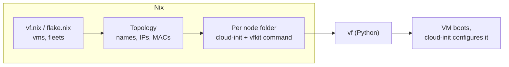
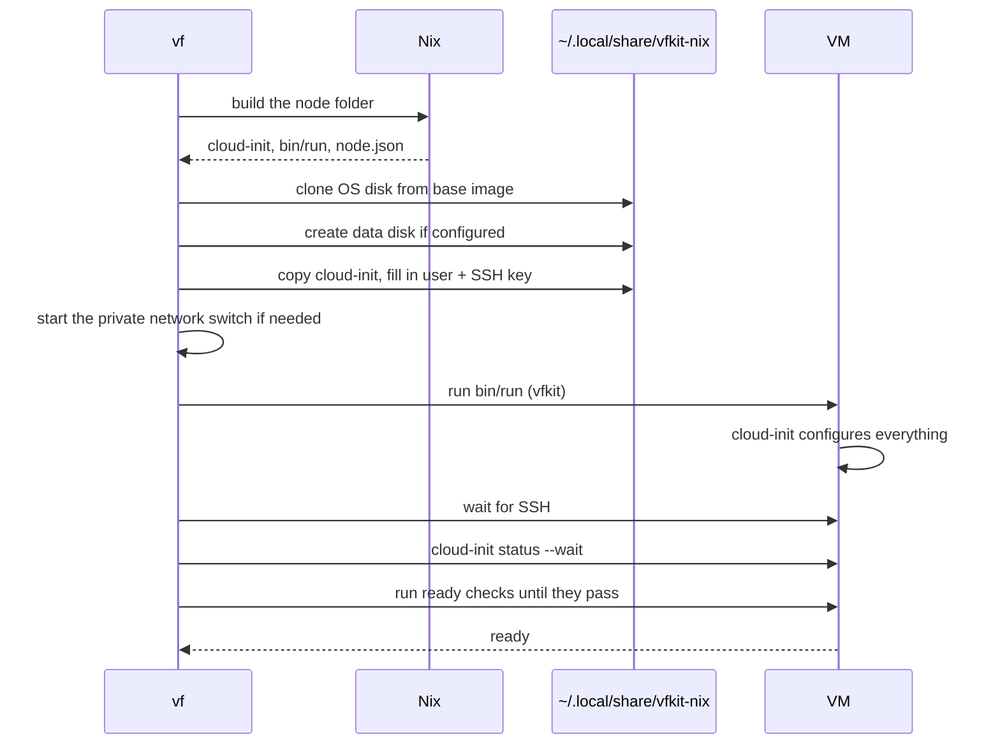
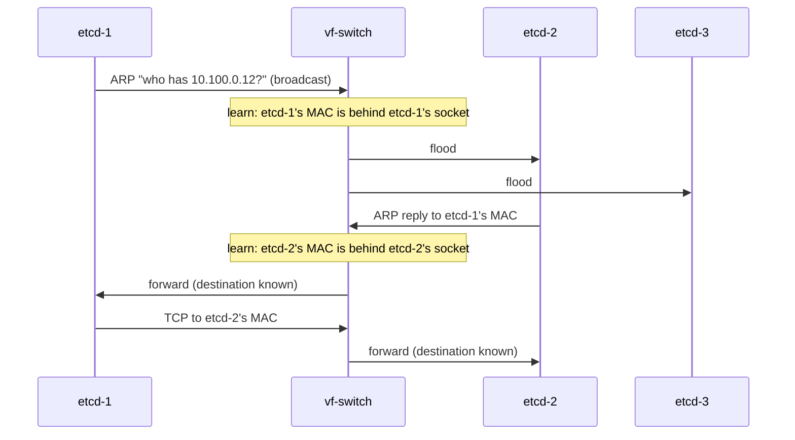
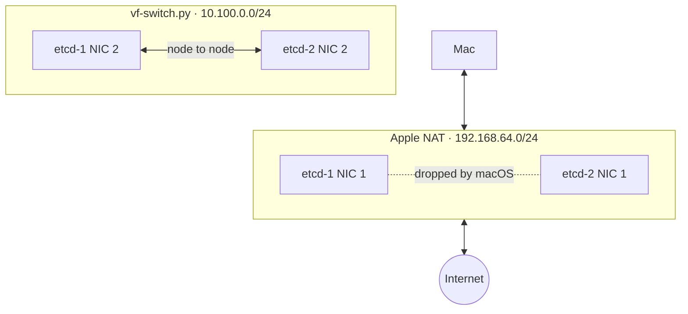
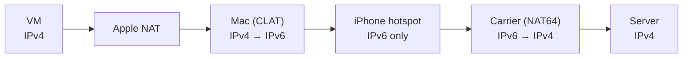

# Building Throwaway VMs on a Mac with vfkit and Nix

I use a Mac, and I keep wanting Linux machines on it. Sometimes one VM to build something that only works on Linux, sometimes three of them to play with a database cluster and break it on purpose. At the same time, I had recently started learning Nix and wanted a real project to learn it with, instead of just reading about flakes and derivations. So I combined the two: a small tool that describes VMs and clusters in Nix and boots them with vfkit. I called it vfkit-nix.

This post covers how it works, what Nix helped with, where it didn't, and a few things about macOS networking I learnt along the way.

It's a developer helper for my own experiments, not an ops tool. There's no TLS on etcd, no security plugin on OpenSearch, and a fixed k3s token. It's meant for VMs you're fine throwing away.

# What it Looks Like

A project is a Nix file describing VMs and fleets:

```nix
{
  vms.dev = {
    memory = 4096;
    data.size = 20;
    mounts = [{ tag = "project"; source = "."; target = "/mnt/project"; }];
  };

  fleets.etcd = {
    blueprints = [ "etcd" ];
    count = 3;
    memory = 1024;
    data.size = 5;
    ipStart = "192.168.64.101";
  };
}
```

And then:

```console
$ vf @etcd up
[etcd-1] vf: booting etcd-1 ... 192.168.64.101
[etcd-2] vf: booting etcd-2 ... 192.168.64.102
[etcd-3] vf: booting etcd-3 ... 192.168.64.103
[etcd-1] vf: waiting for: /usr/local/bin/etcdctl --endpoints=http://127.0.0.1:2379 endpoint health
...
vf: @etcd: all 3 nodes ready
```

That brings up a 3-node etcd cluster in about 10 seconds on my machine. `vf dev rebuild` gives a brand new OS while `/data` stays, and `vf @etcd destroy --data` makes everything go away. Right now it comes with a plain dev VM and 3-node etcd, k3s, OpenSearch and Valkey clusters.

# Why Not Just Use Lima?

Lima already runs Linux VMs on a Mac, it's mature, it's well maintained. If you just need a Linux box, use it.

It wasn't what I wanted here. Lima is a full VM manager: each VM is a YAML file, with its own provisioning scripts, a host agent running alongside it, automatic port forwarding and file sharing. That's a lot of convenience, but it's also a lot of layers between me and the VM. And for a three-node cluster, I'd have needed three YAML files that each know about the other two, which means templating YAML with a script.

I also wanted to learn what's underneath. What does it actually take to boot a VM on macOS? How does the VM get its network? How does a cloud image know which user to create? Using Lima would have answered "how do I use Lima", which wasn't the question. So I went one layer down, to vfkit.

# vfkit

vfkit is a small command line tool from the CRC/Podman folks that wraps Apple's Virtualization framework. You give it CPUs, memory, disks and network devices as flags, and it runs a VM. No daemon, no root, nothing installed system-wide.

```bash
vfkit --cpus 2 --memory 2048 \
  --bootloader "efi,variable-store=efivars,create" \
  --device "virtio-blk,path=disk.raw" \
  --device "virtio-net,nat,mac=02:44:53:ef:7f:b6" \
  --cloud-init "user-data,meta-data,network-config" \
  ...
```

That's all it does. It doesn't know about clusters, users or packages. It boots a VM with the devices you asked for.

The configuring part is cloud-init, which pretty much every cloud image already runs on first boot. It reads a config and creates users, writes files, installs packages and runs commands. So if a Debian cloud image boots with a cloud-init config attached, it configures itself, and I don't need any agent inside the VM.

So the job was: for every VM, produce a few cloud-init files and the exact vfkit command. That's where Nix comes in.

# What Nix Solves Here

Generating some files and running a command sounds like a Python or bash script, and an early version was exactly that. Once it grew past one VM, the script started needing things Nix already has.

## Pinning downloads by hash

Every VM needs a Debian image, and the clusters need etcd, k3s or OpenSearch releases. In a script, that's a `curl`, and then either trusting whatever comes back, or writing my own checksum checks and my own cache so I don't download a 1 GB OpenSearch tarball every time.

In Nix, a download is declared with its hash:

```nix
pkgs.fetchzip {
  url = "https://github.com/etcd-io/etcd/releases/download/v${settings.version}/etcd-v${settings.version}-linux-arm64.tar.gz";
  inherit (settings) hash;
}
```

Nix downloads it once, checks the hash, and keeps it in the store. After that, it doesn't fetch the URL again. If the bytes at the URL change, the build fails with a `hash mismatch` before anything boots.

## Download once, share everywhere

Because those releases are in the store, the same directory can be shared into every VM read-only over virtiofs, mounted at `/opt/vf/<name>`. A 1 GB OpenSearch tarball isn't copied three times, it's mounted three times. OpenSearch even runs straight from that read-only mount, with only its config, logs and data on local disk. That's most of why clusters come up in seconds: nothing is downloading.

## The topology is a value

etcd needs every node to know every peer for `initial-cluster`. OpenSearch needs seed hosts. k3s agents need the server's address. When the whole fleet is a value in a real language, a blueprint can just compute that:

```nix
initial-cluster = lib.concatMapStringsSep ","
  (n: "${n.name}=http://${peerAddr n}:2380") fleet.nodes;
```

which turns into

```text
etcd-1=http://10.100.0.11:2380,etcd-2=http://10.100.0.12:2380,etcd-3=http://10.100.0.13:2380
```

No templating inside the VM, no discovery service. An earlier version did YAML merging and jinja templating inside the guest, and a dropped newline once broke an etcd config. Now the config is computed before boot, and what you read is what etcd gets.

Names, IPs and MAC addresses are worked out up front too. Nodes are `<fleet>-<n>`, IPs count up from `ipStart`, and the MAC address is a hash of the node name, so it stays the same across rebuilds:

```nix
macFor = s:
  let h = builtins.hashString "sha256" s; in
  "02:" + lib.concatMapStringsSep ":" (i: builtins.substring (i * 2) 2 h) [ 0 1 2 3 4 ];
```

The `02:` prefix marks it as a locally administered address, i.e. not assigned to a hardware vendor.

## Types and errors before boot

The config schema is declared with the NixOS module system, so `memory = "2g"` fails with the exact option path before anything boots. On top of that, each blueprint declares its settings with defaults:

```nix
settings = {
  version = "3.9.0";
  hash = "sha256-...";
  nodeRoles = [ "cluster_manager" "data" "ingest" ];
  heap = null;
  extraConfig = { };
};
```

and a small check compares what you wrote against those defaults:

```text
error: vfkit-nix: opensearch-1: unknown setting 'opensearch.hep' (valid: extraConfig hash heap nodeRoles version)
error: vfkit-nix: cache-1: 'valkey.maxmemory' must be of type string, got int
```

Before this, a typo like `opensearch.hep = "1g"` was silently ignored.

## Tools without installing tools

`vf` needs vfkit, `qemu-img` and Python. With Nix, `nix develop` puts all of them on the PATH, pinned by the `flake.lock`, and nothing is installed globally.

## Every VM is a folder you can read

Each node builds into a folder in the Nix store:

```text
cloud-init/user-data       base config + blueprints, merged
cloud-init/meta-data       instance-id, hostname
cloud-init/network-config  the network cards, matched by MAC address
bin/run                    the exact vfkit command
node.json                  image, disk sizes, ready checks, notes
```

`vf etcd-1 show` prints all of it. This turned out to be the most useful debugging feature. When something was off, the answer was usually in one of these files.

# Where Nix Doesn't Help

Nix doesn't run anything. It builds files, and that's it. Starting VMs, creating disks, waiting for SSH, stopping things: none of that is Nix. That's all `vf`, a single Python file using only the standard library. So the split is: Nix generates, `vf` runs.



Nix doesn't go inside the VMs. The guests are plain Debian or Fedora configured by cloud-init. I thought about NixOS guests, but building Linux packages from a Mac needs a Linux builder, and I wanted the VMs to feel like normal Linux machines anyway. That's also why the blueprints download upstream release binaries instead of using the etcd or k3s packages from nixpkgs: those would have to be built for Linux, and my Mac can't do that by itself.

It costs a second or two per command. `vf` evaluates the project on every call, so even `vf list` has a small delay. For a dev tool I'm fine with that.

Sizes can surprise you. The normal `python3` package on macOS pulled in about 1.4 GiB of Apple SDK and LLVM, just to run a script. Switching to `python3Minimal` fixed it, but I'd never have noticed without measuring.

Flakes only see files tracked by git. Add a new file, forget to `git add` it, and Nix acts like it doesn't exist. It's documented, but it's an easy one to trip on when you're new.

# vf, the Running Part

Here's what `vf etcd-1 up` actually does:



A few details worth mentioning.

## Your user, without your user in the store

The VM's user is your Mac username with your SSH key, and passwordless sudo. But the Nix store is readable by everyone on the machine, and I didn't want usernames or keys in it. So the generated cloud-init has placeholders, `@VF_USER@` and `@VF_SSH_PUBKEY@`, and `vf` fills them in when it copies the files into the VM's state folder. The SSH key itself is generated on first use and lives in `~/.local/share/vfkit-nix/`.

## Finding a DHCP address

For static IPs, `vf` already knows the address. For DHCP, it has to ask macOS. The Mac's DHCP server writes its leases to `/var/db/dhcpd_leases`, which looks like this:

```text
{
	name=dev
	ip_address=192.168.64.19
	hw_address=1,2:ef:26:e:9a:a3
	...
}
```

`vf` looks up the node's MAC address there. Note the `hw_address`: the MAC is `02:ef:26:0e:9a:a3`, but macOS's `bootpd` writes it without leading zeros, as `2:ef:26:e:9a:a3`, so a plain string comparison never matches and the MAC has to be rewritten in the same format first. Some clients also identify themselves with a DUID instead of the MAC, so there's a fallback to look up the lease by hostname.

## Waiting for "actually ready"

`vf up` doesn't call a node ready when SSH works, or even when cloud-init is done. Each blueprint gives a `ready` command, and `vf` runs it inside the VM over and over until it succeeds:

| Blueprint | Ready when |
|---|---|
| etcd | `etcdctl endpoint health` |
| k3s (first server) | all nodes in the fleet show `Ready` |
| k3s (agent) | the `k3s-agent` service is active |
| OpenSearch | cluster health with `wait_for_nodes=<fleet size>` doesn't time out |
| Valkey (replica) | `master_link_status:up` |

That's the difference between "the VMs are up" and "the cluster works".

## Fleets in parallel

`vf @etcd up` builds every node in one `nix build`, then starts one `vf <node> up` per node in parallel, prefixing each line with the node name. That's where the `[etcd-1]` in the output comes from. Stop, kill and destroy work the same way.

## Stopping

Graceful stop is just `systemctl poweroff` over SSH and waiting for vfkit to exit. If that doesn't happen within 60 seconds, there's a hard stop: vfkit has a small REST API on a Unix socket, and `vf` posts `{"state": "HardStop"}` to it.

# Networking

## VMs can't talk to each other

Apple's Virtualization framework gives each VM a NAT network, `192.168.64.0/24`. The Mac can reach every VM, every VM can reach the internet, but VMs can't reach each other.

That surprises people, because behind most NATs (a home router, a VirtualBox NAT network, a Docker bridge) machines can see each other. So here's how I checked it, on macOS 27.2.1 with three etcd VMs running.

From etcd-1, the gateway answers and etcd-2's NAT address doesn't:

```console
etcd-1$ ping -c3 192.168.64.1
3 packets transmitted, 3 received, 0% packet loss
etcd-1$ ping -c3 192.168.64.102
3 packets transmitted, 0 received, 100% packet loss
etcd-1$ nc -zv -w2 192.168.64.102 2379
nc: connect to 192.168.64.102 port 2379 (tcp) failed: No route to host
etcd-1$ ip neigh show dev enp0s1
192.168.64.102 INCOMPLETE
192.168.64.1 lladdr 5e:9b:a6:86:00:64 REACHABLE
```

`INCOMPLETE` means etcd-1 never got an ARP reply. This isn't a firewall dropping pings: the VMs can't even learn each other's MAC address. To see where the ARP goes missing, I ran `tcpdump` on both VMs at the same time:

```text
# on etcd-1
02:44:53:ef:7f:b6 > ff:ff:ff:ff:ff:ff, ARP, Request who-has 192.168.64.102 tell 192.168.64.101
02:44:53:ef:7f:b6 > ff:ff:ff:ff:ff:ff, ARP, Request who-has 192.168.64.102 tell 192.168.64.101
02:44:53:ef:7f:b6 > ff:ff:ff:ff:ff:ff, ARP, Request who-has 192.168.64.102 tell 192.168.64.101

# on etcd-2
02:7e:28:a0:5a:e6 > ff:ff:ff:ff:ff:ff, ARP, Request who-has 192.168.64.1 tell 192.168.64.102
5e:9b:a6:86:00:64 > 02:7e:28:a0:5a:e6, ARP, Reply 192.168.64.1 is-at 5e:9b:a6:86:00:64
```

Three broadcasts leave etcd-1 and none of them reach etcd-2. etcd-2's capture works fine (it sees its own ARP to the gateway and the reply), so the broadcasts are dropped somewhere in between. A VM can talk to the bridge itself (that's the Mac, and through it the internet), but never to another VM.

For a single dev VM that's fine. A cluster needs it, though. The usual answer is a bridged or host-only network, but those need root every time a VM starts.

## A socket instead of a network card

vfkit also lets you back a VM's network card with a Unix datagram socket.

```bash
--device "virtio-net,unixSocketPath=/path/to/etcd.sock,mac=02:53:cf:cc:3f:00"
```

With this, every Ethernet frame the VM sends comes out as one datagram on that socket, and every datagram sent back to it arrives in the VM as a frame. No IP stack or routing on the Mac side, just raw frames.

So if each VM in a fleet gets a second network card like this, all pointing at the same socket path, then whatever program is listening on that path sees every frame from every VM. Something that receives Ethernet frames and decides where to send them is a switch.

## Writing a learning switch

That's `vf-switch.py`, about 60 lines of Python.

A network switch has one job: when a frame comes in on a port, send it out on the port where the destination lives. It doesn't know where anything lives at the start, so it learns.

An Ethernet frame starts with two addresses:

```text
 0               6               12      14
 ├───────────────┼───────────────┼───────┼─────────── ...
 │ destination   │ source        │ type  │ payload
 │ MAC (6 bytes) │ MAC (6 bytes) │       │
```

Every time a frame arrives, the switch looks at the source MAC and writes down "this MAC lives behind the port this frame came from". In this switch, a "port" is just the address of the VM's socket that sent the datagram. So the whole memory of the switch is one dictionary:

```python
macs: dict[bytes, str] = {}   # source MAC -> peer socket path
peers: set[str] = set()       # every socket we've heard from
```

Then it looks at the destination MAC and decides what to do:

- If it's a broadcast or multicast address (the lowest bit of the first byte is 1), every port gets a copy. ARP requests ("who has 10.100.0.12?") are broadcasts, so this is how nodes find each other in the first place.
- If it's a MAC the switch hasn't seen yet, it also sends a copy everywhere, because it has no idea where the destination is. This is called flooding.
- If it's a MAC the switch knows, it sends the frame only to that one port.

```python
data, peer = s.recvfrom(65536)
dst, src = data[0:6], data[6:12]
macs[src] = peer                          # learn

if dst[0] & 1 or dst not in macs:         # broadcast, multicast or unknown
    for p in list(peers):
        if p != peer:
            send(data, p)                 # flood
elif macs[dst] != peer:
    send(data, macs[dst])                 # forward
```

Here is what that looks like when etcd-1 talks to etcd-2 for the first time on a freshly started switch:



After the first exchange the switch knows where both of them live, and every later frame goes to exactly one place. etcd-3 never sees the traffic between 1 and 2. That's how a basic hardware switch behaves.

A few practical details:

- Joining: when vfkit connects, it sends a short handshake message before any real frames. Anything shorter than 14 bytes can't be an Ethernet frame (there isn't even room for both addresses and the type), so the switch just records the sender as a peer and ignores the content.
- Leaving: when a VM is stopped, its socket disappears. The next send to it fails with `ENOENT` or `ECONNREFUSED`, and the switch forgets that peer and every MAC it had learnt behind it.
- Being full: if a send fails because the buffers are full (`ENOBUFS`), the frame is dropped. A real switch under load does the same, and TCP inside the VMs retransmits. The socket buffers are set bigger than the defaults to make this rare.

One switch runs per network, as a normal process under my user, started on demand by `vf up`. The Mac's own networking isn't touched at all, which also means the Mac itself can't reach this network. Only VMs on it can.

I measured around 2.8 Gbit/s through it, which is plenty for a dev cluster.

## Two network cards per node

So every node in a fleet ends up with two network cards:



| | Network | Reaches |
|---|---|---|
| NIC 1 | Apple NAT | The internet and the Mac |
| NIC 2 | vf-switch | Other nodes on the same network |

Fleets with more than one node get the private network automatically, and every node's `/etc/hosts` lists its fleet, so `etcd-2` resolves to its private IP. The blueprints use private IPs for anything node to node: etcd peers, k3s flannel traffic, OpenSearch transport, Valkey replication. The NAT IP is what you use from the Mac, for `curl`, `etcdctl` or `kubectl`.

The network config inside the VM matches each card by MAC address rather than by interface name, so it doesn't matter what the distro decides to call it (`enp0s2` on Debian, for example):

```yaml
ethernets:
  vfnat:
    match: { macaddress: 02:44:53:ef:7f:b6 }
    addresses: [192.168.64.101/24]
    mtu: 1280
  vfprivate:
    match: { macaddress: 02:53:cf:cc:3f:00 }
    addresses: [10.100.0.11/24]
```

For static NAT IPs I start at `.100`, because macOS hands out DHCP leases from the bottom of the range, and I didn't want a dev VM on DHCP taking an address meant for an etcd node.

## The 1280 MTU

You might have noticed `mtu: 1280` on the NAT interface. That number came out of a bug.

While testing builds, booting VMs over and over, I hit a problem on one network: the VM booted fine, `ping deb.debian.org` worked, plain HTTP worked, but `apt` hung when downloading over HTTPS. Same image, same config, and on another network it was fine.

"Small things work, big things hang" usually points at the MTU. Every network link has a largest packet it can carry, its MTU. Normally that's 1500 bytes. When a packet is too big for the next link, the router is supposed to drop it and send a message back to the sender: "too big, the limit here is N". The sender then makes its packets smaller and tries again. If that message never arrives, the sender doesn't know anything is wrong. Its big packets just disappear, every time.

So I went looking for the link that was too small, and for where the message was getting lost.

### The network has no IPv4

The network was my iPhone's hotspot, on a mobile network that only does IPv6. There's no IPv4 at all.

A lot of the internet is still IPv4-only, so the Mac fakes it. When a program sends an IPv4 packet, macOS rewrites it as an IPv6 packet and sends that instead. A gateway at the mobile carrier rewrites it back into IPv4 and sends it on to the server. Replies come back the same way, in reverse.

The two halves have names. The Mac's half is called CLAT, and the carrier's half is called NAT64.

> CLAT (customer-side translator) runs on your device. It gives programs an IPv4 address to use, and turns each IPv4 packet into an IPv6 packet. The server's IPv4 address goes into the last 32 bits of a special IPv6 address, so `1.1.1.1` becomes `64:ff9b::101:101`.
>
> NAT64 runs at the carrier. It receives those IPv6 packets, takes the IPv4 address back out of the last 32 bits, and sends the packet on as IPv4 from one of its own public IPv4 addresses. It's the same idea as the NAT in a home router, with a translation step added.
>
> Together, the two halves are called 464XLAT: IPv4 to IPv6 on your device, then IPv6 to IPv4 at the carrier.

You can see the Mac's half in `ifconfig`: there's a placeholder IPv4 address, `192.0.0.2`, a line marked `clat46`, and the special prefix, `64:ff9b::`.

```text
en0: flags=88e3<UP,BROADCAST,SMART,RUNNING,NOARP,SIMPLEX,MULTICAST> mtu 1500
	inet 192.0.0.2 netmask 0xffffffff broadcast 192.0.0.2
	inet6 …  prefixlen 64 clat46
	nat64 prefix 64:ff9b:: prefixlen 96
```

So an IPv4 packet from a VM goes through two rewrites before it reaches the server:



One detail of the rewriting matters here. An IPv6 header is 20 bytes longer than an IPv4 header, so every packet gets 20 bytes bigger on the way.

### Finding the small link

`tracepath` sends packets towards a server and reports any router that says "too big".

Over IPv4, it gets nowhere. Nothing past the Mac answers at all:

```text
$ tracepath -4 -n 1.1.1.1
 1?: [LOCALHOST]                      pmtu 1500
 1:  192.168.64.1                     0.176ms
 2:  no reply
 3:  no reply
 ...
     Too many hops: pmtu 1500
```

Over IPv6, it finds the limit straight away, at the hotspot:

```text
$ tracepath -6 -n 2606:4700:4700::1111
 1?: [LOCALHOST]                      pmtu 1500
 1:  fd60:…  (the Mac)                0.358ms
 2:  2409:…  (the hotspot)            4.318ms
 3:  2409:…  (the hotspot)            4.123ms pmtu 1300
 ...
     Resume: pmtu 1300
```

So the hotspot can only send packets of up to 1300 bytes. An IPv4 packet grows by 20 bytes when it's rewritten, so the biggest IPv4 packet that still fits is 1300 − 20 = 1280.

### Checking it with real downloads

To make sure, I set the VM's MTU to different values and downloaded a 9.6 MB file from `deb.debian.org` over HTTPS, once over IPv4 and once over IPv6:

| VM MTU | HTTPS over IPv4 | HTTPS over IPv6 |
|---|---|---|
| 1500 | hangs | works |
| 1480 | hangs | works |
| 1400 | hangs | works |
| 1300 | hangs | works |
| 1290 | hangs | |
| 1281 | hangs | |
| 1280 | works | works |

1281 hangs and 1280 works. The limit is exact.

Why does IPv6 cope when IPv4 doesn't? When the VM sends an IPv6 packet that's too big, the hotspot sends back "too big, the limit is 1300", the VM makes its packets smaller, and the download carries on.

With IPv4, the VM sends a 1300-byte packet, the Mac rewrites it into 1320 bytes of IPv6, and the hotspot can't send it. But the hotspot sees an IPv6 packet from the Mac, so if it complains, it complains to the Mac, not to the VM. The VM never hears anything. It just sees its packet vanish, sends it again, and it vanishes again. This is called a PMTU black hole.

I didn't look at the Mac's side to see exactly where the message gets lost, because that needs root. From the VM's side it doesn't matter: no message comes back, and the packet is gone.

### Why only HTTPS hangs

Here's a capture inside the VM while `curl -4` hangs:

```text
VM > server: Flags [S],  options [mss 1460, ...]
server > VM: Flags [S.], options [mss 1260, ...]
VM > server: Flags [P.], length 1574             TLS ClientHello
VM > server: Flags [.],  seq 1:1249, length 1248  IP length 1300, DF set
VM > server: Flags [.],  seq 1:1249, length 1248  retransmit
VM > server: Flags [.],  seq 1:1249, length 1248  retransmit
...
```

The first two lines are the TCP handshake. Those packets are tiny, so they get through.

Then the VM sends the first TLS message, the ClientHello, where the client says hello and offers its keys. It's about 1.5 KB. Most of that is a post-quantum key, which Debian 13's OpenSSL sends by default and which is over a kilobyte by itself. That's too big for one packet, so it's split, and the first piece is a 1300-byte packet. It never arrives. The VM keeps sending it again until `curl` gives up.

Why 1300 bytes, if the VM's MTU is 1500? During the handshake, each side says the largest chunk of data it wants per packet, the MSS. The server's side came back as 1260. Something on the way had lowered it to fit the hotspot, but forgot about the 20 extra bytes: 1260 bytes of data plus 40 bytes of IPv4 and TCP headers is a 1300-byte packet, which becomes 1320 bytes after the rewrite. Just too big.

Downloads are fine. A plain HTTP download of the same 9.6 MB file over IPv4, at MTU 1500, finished without trouble. Only big packets going up get lost. That matches the original symptom: `ping` and plain HTTP send small packets up and get big ones back down, which works. HTTPS is the first thing that sends a big packet up.

### Why the Mac itself is fine

The Mac's own IPv4 traffic doesn't hit this. macOS knows its IPv4 is being rewritten, so it uses an MTU of 1280 for its own IPv4 traffic:

```console
$ route -n get default
   route to: default
  interface: en0
 recvpipe  sendpipe  ssthresh  rtt,msec    rttvar  hopcount      mtu     expire
       0         0         0         0         0         0      1280         0
```

The VMs don't get that. Their packets come through Apple's NAT at whatever size the VM picked, and the VM has no idea its traffic will end up as IPv6.

### Why apt uses IPv4 at all

The VM does have working IPv6. macOS gives it a private IPv6 address (one starting with `fd`) and passes that traffic on too, which is how `tracepath -6` worked.

But Linux prefers IPv4 when its only IPv6 address is a private one, so it lists the IPv4 addresses first:

```console
$ getent ahosts deb.debian.org
167.82.58.132
167.82.62.132
2a04:4e42:fe7::644
2a04:4e42:fea::644
```

So `apt` picks IPv4 and hangs, even though IPv6 would have worked.

### A ping test would have been misleading

The usual first test is to ping with bigger and bigger packets, marked "don't fragment", and see where they stop. On this network that gives the wrong answer:

| IPv4 ping size, don't fragment | Replies |
|---|---|
| 1280 | 20 / 20 |
| 1300 | 13 / 20 |
| 1400 | 10 / 20 |
| 1480 | 5 / 5 |
| 1481 and up | 0 |

Pings well above 1280 get through, just with a lot of loss. The replies come back without the "don't fragment" mark, so something on the way is splitting pings into pieces even though they asked not to be. The cut-off at 1480 is the Mac's own Wi-Fi limit, 1500, minus the 20 bytes. TCP packets don't get that help, so only the download test showed the real limit.

### So why 1280

On this network, 1280 is exact: the hotspot's 1300-byte limit, minus the 20 bytes the rewrite adds. It's also the smallest MTU IPv6 allows on any link, which makes it easy to remember, but it isn't guaranteed to work everywhere. On an IPv6-only network that only does that minimum, IPv4 would need 1260. On a normal network with real IPv4, 1500 works fine.

A laptop moves between networks, so 1280 is the default, and it's a setting if your network handles 1500. To check whether your Mac is on a network like this, look for `clat46` in `ifconfig en0`, and for the `mtu` column in `route -n get default`.

## Local Network privacy, and why vf uses /usr/bin/ssh

macOS has a Local Network privacy check: a program has to be allowed before it can connect to addresses on local networks, and VM IPs count. The permission belongs to the app the program runs under, not the program itself. Run Nix's ssh from a terminal that's already allowed, and it works fine. Run the same binary somewhere without that permission, like a launchd job, and it fails right away, while Apple's own ssh works:

```text
/usr/bin/ssh                       -> dev
/nix/store/…-openssh-10.6p1/bin/ssh -> ssh: connect to host 192.168.64.31 port 22: No route to host
```

That's on macOS 27.2.1, same VM, same key, same second. The error is the confusing part: "No route to host" sounds like the VM is down or the network is broken, when it's actually a privacy setting. Apple's binaries in `/usr/bin` aren't affected, so `vf` always uses `/usr/bin/ssh`, whatever is first on the PATH.

# Disks

## The base image and APFS clones

vfkit only boots raw disk images, and the Debian cloud image is a 320 MB qcow2 that becomes a 3 GB raw file. Copying 3 GB per node would be slow and would fill the disk quickly.

APFS has copy-on-write clones. `cp -c` makes a "copy" that shares every block with the original until one of them writes to it. So `vf` converts each image to raw once with `qemu-img`, keeps it read-only, and every VM's disk is an instant clone of it. A VM only costs what it actually writes.

The catch is that clones only work within one APFS volume, and on macOS `/nix` is its own separate volume. So the raw base can't live in the Nix store next to the qcow2, it has to live next to the VM disks in `~/.local/share/vfkit-nix/images/`.

A 3-node OpenSearch cluster with data disks took about 148 MiB of real space on top of the shared base. `du` will happily tell you each `disk.raw` is 20 GB, because it can't see shared blocks.

## The data disk

`data.size = 20` adds a second disk, which is just a sparse file on the Mac, so a 20 GB disk takes up nothing until you write to it.

The VM formats it on first boot. It must never be formatted again, otherwise `rebuild` would wipe the data. So it runs a tiny script at boot:

```bash
d=/dev/disk/by-id/virtio-vfdata
if ! blkid "$d"; then
    mkfs.ext4 -q -L vfdata -E root_owner=1000:1000 "$d"   # blank: format it
else
    resize2fs "$d"                                         # has data: just grow it
fi
```

If `blkid` finds a filesystem, the format is skipped. The `resize2fs` is there so that if you raise `data.size`, the filesystem grows on the next boot. And `root_owner` makes the disk owned by your user instead of root, so `/data` is writable without sudo.

| | OS disk | Data disk |
|---|---|---|
| `stop`, then `up` | kept | kept |
| `rebuild` | new | kept |
| `rebuild --data` | new | new |

The built-in blueprints put their state on the data disk when there is one (`/data/etcd`, `/data/opensearch`, `/data/valkey`), so a cluster can be rebuilt with fresh OSes and still have its data. I tested this: put a key in etcd, `vf @etcd rebuild`, and read it back on another node.

## Why rebuild re-runs cloud-init

cloud-init only runs its first-boot setup once per instance, and it decides that using the `instance-id` in the meta-data. If the ID stays the same, a restarted VM doesn't reconfigure itself, which is what you want for `stop` and `up`.

So the `instance-id` is the node name plus a hash of the generated config:

```text
instance-id: etcd-1-e76f0084fc7f
```

Restarting keeps the same ID, so nothing re-runs. `rebuild` gives a fresh OS disk, so cloud-init runs from scratch anyway. And if you change the config, the hash changes too, so cloud-init treats it as a new instance.

## Your project folder in the VM

The dev VM shares a folder from the Mac using virtiofs, and `source = "."` means the folder your project file is in. So the workflow is: keep the code next to the `flake.nix`, edit it on the Mac, build and run it on Linux at `/mnt/project`. Changes show up live in both directions.

# Blueprints

A blueprint is how a plain VM becomes an "etcd node". It's one Nix file: settings with defaults, and a function that gets this node and its whole fleet and returns cloud-config.

Here's a trimmed version of the Valkey one, because it shows how fleets are used:

```nix
{
  settings = {
    maxmemory = "256mb";
    extraConfig = { };
  };

  config = { lib, node, fleet, settings, ... }:
    let
      primary = builtins.head fleet.nodes;
      isPrimary = node.name == primary.name;
      conf = {
        bind = "0.0.0.0";
        maxmemory = settings.maxmemory;
      } // lib.optionalAttrs (!isPrimary) {
        replicaof = "${primary.privateIp} 6379";
      } // settings.extraConfig;
    in
    {
      packages = [ "valkey-server" ];
      write_files = [{ path = "/etc/valkey/vf.conf"; content = ...; }];
      ready =
        if isPrimary then "valkey-cli ping | grep -q PONG"
        else "valkey-cli info replication | grep -q master_link_status:up";
    };
}
```

The first node is the primary, and every other node gets `replicaof` pointing at it. No election or discovery.

Each built-in blueprint also has an `extraConfig` setting that's merged last into the service's own config file: etcd's config file, k3s's `config.yaml`, `opensearch.yml`, `valkey.conf`. So anything the blueprint doesn't handle can be set directly:

```nix
opensearch.extraConfig."cluster.routing.allocation.disk.threshold_enabled" = false;
k3s.extraConfig.disable = [ "traefik" ];
etcd.extraConfig.auto-compaction-retention = "1h";
```

## Values only known at boot

Not everything can be worked out in Nix. k3s wants the node's external IP in its TLS certificate (so `kubectl` from the Mac works), and the name of the private interface for flannel. With DHCP, the IP isn't known until boot, and interface names depend on the distro.

So the generated k3s config has placeholders, and a small script fills them in on first boot:

```bash
nat_ip=$(ip -4 route get 1.1.1.1 | sed -n 's/.* src \([0-9.]*\).*/\1/p')
private_if=$(ip -o -4 addr show to 10.100.0.13 | awk '{print $2}')
sed -e "s/@NAT_IP@/$nat_ip/g" -e "s/@PRIVATE_IF@/$private_if/g" \
    /usr/local/lib/vf/k3s.yaml > /etc/rancher/k3s/config.yaml
```

`ip route get 1.1.1.1` asks the kernel which source address it would use to reach the internet, which is the NAT IP. `ip addr show to <ip>` finds the interface that has the private IP.

# Polishing It, and What Broke

Once it worked, I used Claude to test edge cases and clean up the error messages and templates. We booted every stack on my Mac each time instead of only checking that it evaluates, and that caught a couple of bugs.

k3s agents crash-looping: I had moved k3s from its install script to a plain `config.yaml` with a systemd unit, so it's easier to read. In the template, `disable = [ "traefik" ]` was set for the whole fleet. The server was fine, but the agents kept restarting:

```text
level=fatal msg="Error: flag provided but not defined: -disable"
```

k3s agents refuse server-only keys in their config file. Server-only settings now go on the server role, and the docs say so.

Nodes swapping identities: To make fleet startup faster, the parent process builds all nodes in one `nix build` and hands each child its output path, assuming `nix build` prints the paths in the order I asked for them. It doesn't. etcd didn't notice, because its nodes are interchangeable. Valkey did, since node 1 is the primary: node 3 announced itself as the primary, and node 1 never became ready. Now the paths are matched by node name, since each one ends in `vfkit-node-<name>`.

Pinning down the 1280 MTU: It booted VMs on my Mac while I was on the iPhone hotspot, and ran the tests. That's how 1280 turned out to be the hotspot's 1300-byte limit minus the 20 bytes the IPv4-to-IPv6 rewrite adds.

# Takeaways

Nix works well for describing things, pinning downloads and producing files you can inspect. It doesn't run processes, so that part is in Python. Keeping the two separate made both simpler.

Most of the pieces already existed: vfkit, cloud-init, APFS clones. The switch is a dictionary from MAC address to socket, and a cluster config is a function of the node list. vfkit-nix mostly connects them, which makes `vf @etcd rebuild` cheap enough to run often.

The code is at [github.com/melonlorrd/vfkit-nix](https://github.com/melonlorrd/vfkit-nix).
